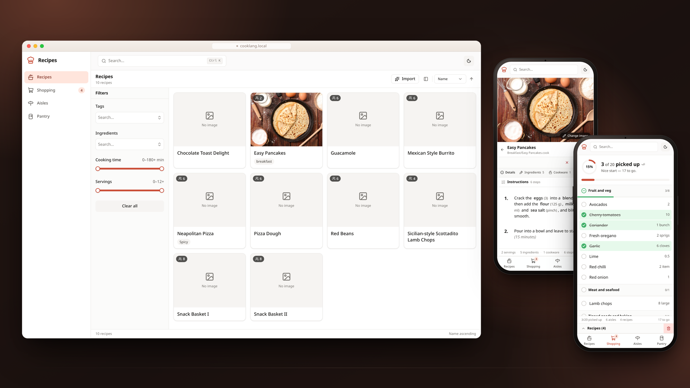
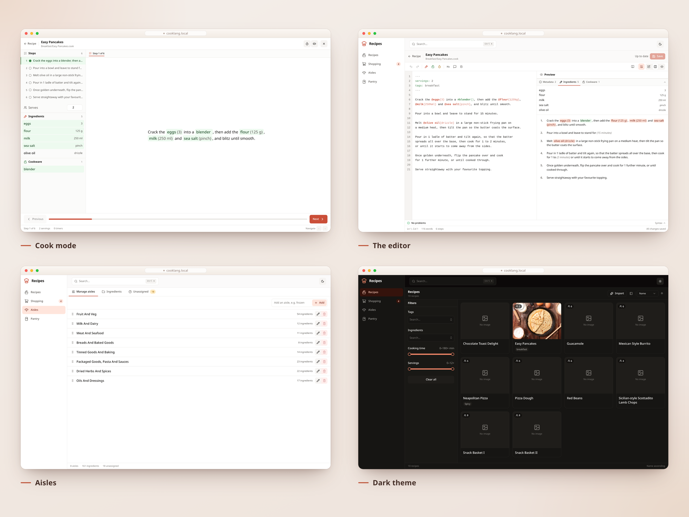
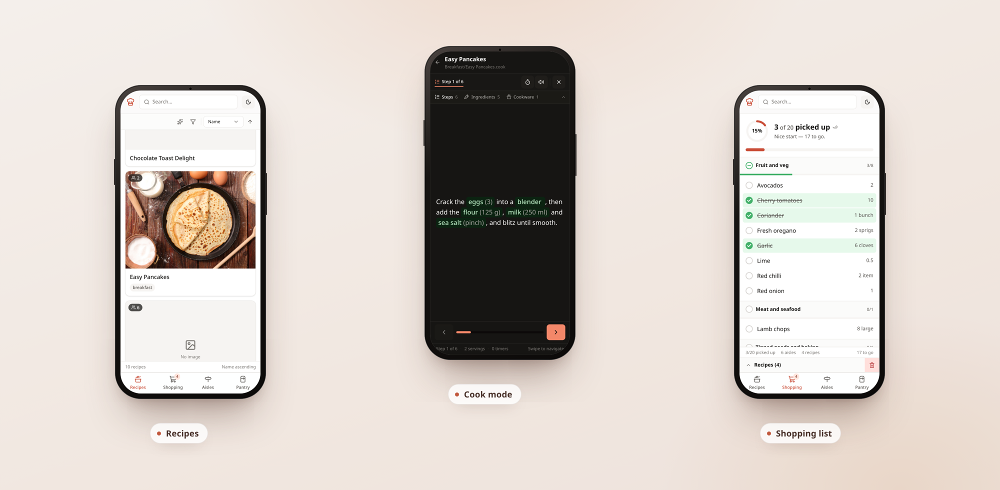

# cooklang-web

A self-hosted web app for a [Cooklang](https://cooklang.org/) recipe library.
Point it at a directory of `.cook` files and it gives you a browsable,
searchable collection, a combined shopping list, and a pantry whose contents
are deducted from that list.



### Features

- **Recipes**: browse, search and filter a directory of `.cook` files,
  including subdirectories, with a cook mode that walks you through the steps
  and runs timers.
- **Editing**: a Cooklang editor with syntax highlighting, a live preview,
  parser diagnostics, undo/redo, and ingredient and cookware autocomplete
  drawn from the whole library.
- **AI import**: paste a recipe URL and have an LLM turn the page into
  Cooklang. The result is shown in an editor and preview first, and ingredients
  are matched against the library's existing vocabulary.
- **Shopping lists**: combine recipes at any scale, with quantities merged
  across them and grouped by supermarket aisle.
- **Aisles**: edit `aisle.conf` from the app. Arrange the aisles in the order
  you walk the shop, see which ingredients have no aisle yet, and give one an
  aisle straight from the shopping list.
- **Pantry**: track what you have in stock. Anything listed is subtracted from
  the shopping list automatically.





## Tech Stack

- **Framework**: [SvelteKit](https://kit.svelte.dev/) - Full-stack web framework
- **UI**: [Tailwind CSS](https://tailwindcss.com/) v4 with a custom token layer, and
  [Bits UI](https://bits-ui.com/) for accessible primitives
- **Icons**: [Lucide Svelte](https://lucide.dev/)
- **Recipe parsing**: [@cooklang/cooklang](https://github.com/cooklang/cooklang-rs) (WASM) for display, plus the [cook CLI](https://github.com/cooklang/cookcli) for shopping lists
- **AI import**: any OpenAI-compatible `/chat/completions` endpoint, with DeepSeek as the default
- **Images**: [imgproxy](https://imgproxy.net/) behind a caching [Caddy](https://caddyserver.com/)
- **Deployment**: Node.js adapter, shipped as a container

## Development

### Prerequisites

- Node.js 26
- npm
- Optionally the [cook CLI](https://github.com/cooklang/cookcli), which is only
  needed for shopping lists

### Setup

Install dependencies:

```sh
npm install
```

### Running the Development Server

Start the development server with hot module replacement:

```sh
npm run dev
```

Point it at your own recipes with `RECIPE_PATH`; it defaults to the sample
`recipes/` directory in this repo.

### Checks

Typecheck, lint and test in one go. This is what CI runs:

```sh
npm run verify
```

Individually: `npm run check`, `npm run lint`, `npm test`. `npm run format`
applies Prettier.

Tests cover the logic that is easy to get wrong: the pantry and aisle
file parsers, URL slugs, imgproxy URL signing, quantity formatting, aisle
ordering, aisle coverage and pantry unit comparisons. The parsers round-trip
their real config byte for byte, comments included, and the aisle one reorders
a category without disturbing the lines around it. The AI importer's URL
safety, JSON-LD extraction, prompt vocabulary and ingredient matching are
covered without calling a model. Behaviour that depends on the `cook` binary is
checked by `scripts/smoke-cook.mjs` against the real binary instead of a mock.

## Building

Create a production build:

```sh
npm run build
```

Preview the production build locally:

```sh
npm run preview
```

## Deployment

The recipe library is expected to live on network storage, which is slow to
read from. Two things keep that off the request path:

- **A recipe index.** Recipes are read and parsed once and kept in memory,
  refreshed only when a file's mtime or size changes.
- **An image pipeline.** `imgproxy` resizes images to the sizes actually
  rendered, and a caching Caddy in front of it means a given derivative is
  produced once. A typical recipe photo drops from ~950 KB to ~40 KB.

```
browser → caddy (cache) → imgproxy → recipe directory (read-only)
                        → app      → recipe directory (read-write)
```

Copy `.env.example` to `.env`, set `RECIPES_HOST_PATH` to the recipe
directory, generate a signing key pair, and start the stack:

```sh
openssl rand -hex 32
```

```sh
docker compose up -d
```

The image tag defaults to `latest`. For a reproducible deployment, pin a
release in `.env` so upgrades are explicit:

```sh
COOKLANG_WEB_VERSION=1.2.3

docker compose pull
docker compose up -d
```

Check `/health` after an upgrade. To roll back, set the previous version and
run the same two commands.

Only Caddy publishes a port. `imgproxy` is reachable solely from inside the
compose network, so it cannot be used as an open image resizer.

### Releases

Versions follow SemVer and are cut from `main` with release-please.
`CHANGELOG.md` and GitHub Releases are generated from conventional commit
messages. Images are published to GHCR:

- `1.2.3`: immutable release
- `1.2`, `1`: move within their release line
- `latest`: newest tagged release
- `main`, `main-<sha>`: unstable tip, not a release

Pin production to `1.2.3` (or a digest). See
[docs/RELEASING.md](docs/RELEASING.md) for the release process, immutability
rules, data compatibility policy, and rollback steps.

### Configuration

| Variable              | Default                    | Purpose                                                        |
| --------------------- | -------------------------- | -------------------------------------------------------------- |
| `RECIPE_PATH`         | `./recipes`                | Directory holding `.cook` files                                |
| `COOK_CLI_PATH`       | `cook`                     | Cook CLI binary, used for shopping lists                       |
| `COOK_CLI_TIMEOUT`    | `30000`                    | Cook CLI timeout in ms                                         |
| `RECIPE_INDEX_TTL_MS` | `30000`                    | How long the index serves before re-stat'ing (`0` in dev)      |
| `BODY_SIZE_LIMIT`     | `25M`                      | Largest request body; cover image uploads need headroom        |
| `IMGPROXY_BASE_URL`   | _unset_                    | Where imgproxy is mounted. Unset serves originals from the app |
| `IMGPROXY_KEY`        | _unset_                    | Hex URL-signing key                                            |
| `IMGPROXY_SALT`       | _unset_                    | Hex URL-signing salt                                           |
| `AI_API_KEY`          | _unset_                    | Enables AI import. Key for the chat-completions provider       |
| `AI_BASE_URL`         | `https://api.deepseek.com` | OpenAI-compatible API root                                     |
| `AI_MODEL`            | `deepseek-chat`            | Model used for recipe imports                                  |
| `AI_TIMEOUT_MS`       | `90000`                    | Timeout for one model request, in ms                           |
| `AI_MAX_TOKENS`       | `4096`                     | Upper bound on the generated recipe                            |
| `PROTOCOL_HEADER`     | _unset_                    | Proxy header carrying the scheme; set by compose               |
| `HOST_HEADER`         | _unset_                    | Proxy header carrying the host; set by compose                 |
| `ORIGIN`              | _unset_                    | Public URL, if your proxy sends neither of the above           |

Both `IMGPROXY_KEY` and `IMGPROXY_SALT` must be set alongside
`IMGPROXY_BASE_URL`; if they are not, the app logs a warning and falls back to
serving original images itself.

The `cook` CLI is only needed for shopping lists. Without it the rest of the
app works, and `/shopping` explains what is missing rather than failing.

`PROTOCOL_HEADER` and `HOST_HEADER` are set for you in `docker-compose.yml`.
They are not optional behind a proxy: SvelteKit rejects a form POST whose
`Origin` does not match the origin it believes it is serving, so without them
every submission fails with "Cross-site POST form submissions are forbidden".

### AI recipe import

The **Import** button on the recipe list opens `/recipes/import`. Paste a recipe
page URL and the server fetches it, extracts its schema.org Recipe data (with a
visible-text fallback), and asks a chat model for Cooklang. The result is shown
in the same editor and preview as the normal recipe editor. Nothing is written
until you choose **Create recipe**. The generated recipe keeps the source page's
language, including ingredient names and units, so a German recipe stays German
instead of being translated towards the mostly English library. Existing
library names are reused only when they are the same name in that language,
allowing for case, punctuation, plural and small wording differences. If the
page publishes a cover image, it is downloaded and stored beside the recipe
when the recipe is created.

Set `AI_API_KEY` to enable it. The defaults target DeepSeek:

```sh
AI_API_KEY=sk-...
# AI_BASE_URL=https://api.deepseek.com
# AI_MODEL=deepseek-chat
```

Any provider with an OpenAI-compatible `/chat/completions` endpoint and bearer
authentication can be used instead. Without a key, the page explains what is
missing and the rest of the app works normally.

Ingredient names need the most care. The prompt includes the library's existing
vocabulary and asks the model to reuse a name when it means the same ingredient,
even across plural forms, minor wording differences, or a translated source.
After generation, a second deterministic pass fixes case, punctuation and
singular/plural variants against the library, so `@Tinned Tomatoes{}` becomes
`@tinned tomatoes{}` when that is the existing spelling. It does not collapse
broader or narrower ingredients: `red onion` is not rewritten to `onion`.

The import has limits. It only fetches public http(s) URLs, rejects private and
link-local addresses (including through redirects), refuses pages over 4 MB,
and times out model requests. Page content is treated as untrusted data in the
prompt, and the generated source is parsed before it can be saved.

### Health

`/health` reports whether the recipe directory is readable, how many recipes
were found, whether the `cook` CLI is available, and the running app version,
commit and Cook CLI version. It returns 503 when the recipe directory cannot be
read, so a forgotten volume mount shows up as an unhealthy container instead of
an empty-looking library. The container healthcheck uses it, and Caddy waits for
it before starting. The version fields make bug reports and "which image is
deployed?" questions easy to answer.

### After upgrading the cook CLI

The shopping list and pantry depend on CLI behaviour that unit tests cannot
cover, because the tests mock the binary. `scripts/smoke-cook.mjs` checks it
against the real binary and real recipes:

```bash
docker compose run --rm app node scripts/smoke-cook.mjs
```

It checks that recipes in subdirectories resolve, that `:n` scales them, that
`--base-path` works, that recipe references expand, and that
`config/aisle.conf` and `config/pantry.conf` are discovered automatically, with
stocked ingredients subtracted and unit mismatches warned about instead of
silently ignored.

It also checks the `aisle.conf` grammar the aisles page writes: `|` separates
alternative names and the first one is canonical, `//` starts a comment,
ingredients are matched against the file by the name the recipe writes, and
anything unmatched lands in `other`, the group the shopping list offers an
aisle picker for.
